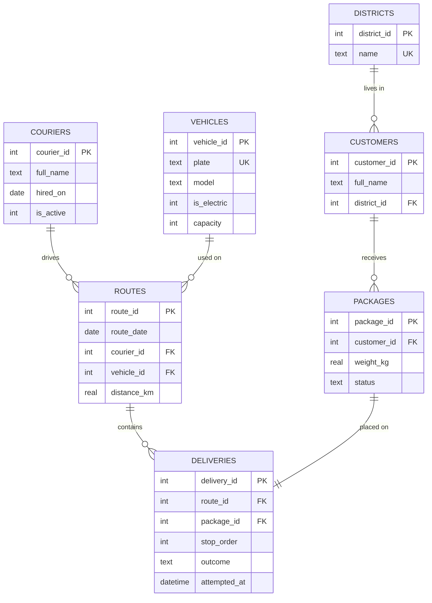

# Delivery Management DB


A relational database for a last-mile delivery station, with **12 SQL queries that go from basic SELECT to window functions, recursive CTEs, triggers, indexes and transactions**. Each query file starts with the question it answers and the SQL concepts it shows.

I worked as a delivery driver in Worms, Germany in summer 2026. This project models the data behind that job (couriers, vans, routes, packages and delivery attempts), and I use it as my SQL practice ground alongside the Database Management Systems course at university. The sample data is generated (no real people or addresses) and covers ~460 routes and ~40,000 packages over two months.

It's the data-side companion of my [Delivery Route Planner](https://github.com/ysufkaratepe/teslimat-rota-planlayici).

## Schema



Design choices in [`schema.sql`](schema.sql):

- **Constraints** protect the data: a courier drives at most one route per day, a van is used once per day, a package can't appear twice on a route, weights must be positive (`UNIQUE`, `CHECK`, `FOREIGN KEY`).
- **Triggers** keep `packages.status` in sync automatically: `out_for_delivery` when a package is put on a route, `delivered`/`failed` when the attempt is recorded.
- **A view** (`route_summary`) gives one ready-made row per route with stops, deliveries and success rate.
- **Indexes** on the columns used for joins and filters.

## Queries

| # | File | Question | Concepts |
|---|------|----------|----------|
| 01 | [basic_select](queries/01_basic_select.sql) | Which electric vans do we have? | `SELECT`, `WHERE`, `ORDER BY`, `LIMIT` |
| 02 | [join](queries/02_join.sql) | The stops of a route with customer and district | `INNER JOIN` over 4 tables |
| 03 | [group_by_having](queries/03_group_by_having.sql) | Districts with a high failed-delivery rate | `GROUP BY`, `HAVING`, aggregates |
| 04 | [left_join](queries/04_left_join.sql) | Routes per courier, including couriers with none | `LEFT JOIN`, `COUNT(column)` |
| 05 | [subquery](queries/05_subquery.sql) | Routes longer than average | scalar subqueries |
| 06 | [cte](queries/06_cte.sql) | Totals and average success rate per courier | `WITH` (CTE) |
| 07 | [window_rank](queries/07_window_rank.sql) | Best courier of every week | `RANK() OVER (PARTITION BY …)` |
| 08 | [window_running](queries/08_window_running.sql) | Daily deliveries, running total, 7-day average | `SUM() OVER`, `LAG()`, `ROWS` frame |
| 09 | [recursive_cte](queries/09_recursive_cte.sql) | A full calendar including days without routes | `WITH RECURSIVE` |
| 10 | [view_and_case](queries/10_view_and_case.sql) | Route quality classes, electric vs. diesel | `VIEW`, `CASE` |
| 11 | [index_explain](queries/11_index_explain.sql) | Does the query use an index? | `EXPLAIN QUERY PLAN` |
| 12 | [transaction](queries/12_transaction.sql) | What if a package is added to a route twice? | `BEGIN` / `ROLLBACK`, constraints |

Example: the best courier of each week (query 07):

```
week      courier         delivered
--------  --------------  ---------
2026-W27  Paula Hoffmann  539
2026-W28  Tim Wagner      487
2026-W29  Hasan Weber     459
...
```

## Indexes in practice

```
$ python -m deliverydb benchmark
Query: SELECT COUNT(*), SUM(weight_kg) FROM packages WHERE customer_id = ?

Without index:   1.943 ms   plan: SCAN packages
With index   :   0.063 ms   plan: SEARCH packages USING INDEX idx_packages_customer (customer_id=?)

The index makes this query about 31x faster.
```

Without the index SQLite reads all ~40,000 packages; with it, it jumps straight to the right rows. (Exact numbers vary by machine.)

## Usage

Only Python 3.10+ is needed; SQLite is built into Python.

```bash
python -m deliverydb build                           # create delivery.db with sample data
python -m deliverydb run queries/07_window_rank.sql  # run one query
python -m deliverydb run-all                         # run all queries
python -m deliverydb benchmark                       # index vs. no index
python -m deliverydb demo-transaction                # constraint + rollback demo
```

You can also open `delivery.db` in [DB Browser for SQLite](https://sqlitebrowser.org/) or the SQLite extension for VS Code and write your own queries.

## Tests

```bash
pip install -r requirements-dev.txt
pytest -v
```

The tests check that the data is reproducible, that every query runs and returns sensible results (for example, the running total equals the real number of deliveries, and the calendar has 31 days), and that constraints, foreign keys and triggers work. GitHub Actions runs them on Windows and Linux.

## Next steps

- [ ] Port the schema to PostgreSQL and compare query plans
- [ ] Add customer time windows and on-time delivery rate
- [ ] Connect it to the Route Planner: plan tomorrow's routes straight from the database
- [ ] A small dashboard (FastAPI or Streamlit) on top of the views

## Author

**Yusuf Karatepe**, Computer Engineering student
[LinkedIn](https://www.linkedin.com/in/yusuf-karatepe-0720923a1/) · [GitHub](https://github.com/ysufkaratepe)
